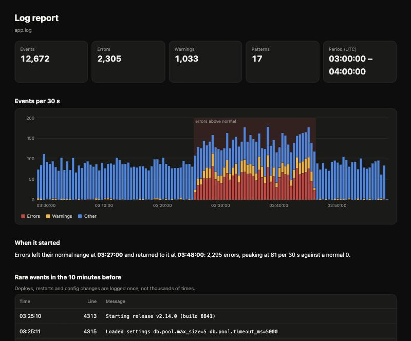

# trag

**Log triage from the command line.** Point it at a log file and it answers
the questions you ask at 3 a.m.: *when did it start, what started happening,
what changed just before, and what is failing the most?*

Python standard library only. Reads application logs, nginx/Apache access
logs, syslog and JSON lines, plain or gzipped.

*Trag* is Croatian for a trace: the trail something leaves behind.



## The idea

A log file is ten thousand lines produced by a few dozen format strings.
`trag` recovers those format strings (it calls them *patterns*) and then
reasons about patterns instead of lines:

```
Timeout acquiring connection after 5000 ms
Timeout acquiring connection after 5000 ms       →   Timeout acquiring connection after <NUM> ms   738×
Timeout acquiring connection after 5000 ms
```

Once lines are patterns, the useful questions become cheap: which patterns
are *new*, which got *louder*, which only exist *after* a certain moment.

## Try it

```bash
pip install .
```

```bash
trag demo
```

```bash
trag summary demo-logs/app.log
```

`trag demo` writes one hour of a web shop's logs containing a real-looking
incident (17,100 lines). This is the actual output of the summary:

```
trag  demo-logs/app.log
  format app · 17,100 lines · 12,672 events · 17 patterns
  2026-11-16 03:00:00 → 2026-11-16 04:00:00 UTC (59 min)
  error 2,305  warn 1,033  info 7,642  debug 1,692
  4,428 stack-trace lines folded into their events

Timeline  (one bar ≈ 1 min)
  all     ▄▆▅▄▅▅▅▄▅▄▄▅▄▅▅▅▄▄▄▄▅▅▄▄▄▅▄▆▇▇█▆█▇▇██▇██▇▆█▇███▇▄▅▅▅▅▅▅▅▄▄▅▄  peak 178
  errors   ▁      ▁  ▁▁ ▁     ▁   ▁  ▄▆▆█▅▇▆▇▇▇▆██▆▆▇▇█▇█▅     ▁     ▁  peak 81
          03:00:00                                            04:00:00

When it started
  Errors left their normal range at 03:27:00 and returned to it at 03:48:00.
  2,295 errors in that period; peak 81 per 30 s against a normal 0.

Rare events in the 10 minutes before  (deploys, restarts, config changes)
  03:25:10  line 4313    Starting release v2.14.0 (build 8841)
  03:25:11  line 4315    Loaded settings db.pool.max_size=5 db.pool.timeout_ms=5000
  03:25:12  line 4323    Release v2.14.0 is live

New patterns  (never seen in the first quarter of the log)
  03:25:10  038de7  INFO       1×  Starting release v2.<NUM> (build <NUM>)
  03:25:11  a5e34d  INFO       2×  Loaded settings db.pool.max_size=<NUM> db.pool.timeout_ms=<NUM>
  03:25:12  ed43f4  INFO       2×  Release v2.<NUM> is live
  03:27:03  feb071  WARN     738×  Connection pool exhausted (size=<NUM>, in_use=<NUM>, waiting=<NUM>)
  03:27:08  025296  ERROR    738×  Timeout acquiring connection after <NUM> ms
  03:27:08  f5d809  ERROR    738×  Failed to create order for user=<NUM>: PoolTimeout
  03:27:08  98c946  ERROR    738×  POST /api/orders status=500 duration=<NUM>ms user=<NUM>
  03:28:13  4f0838  ERROR     72×  Readiness probe failed: database check timed out
  03:47:00  443aeb  WARN       1×  Rolling back to release v2.<NUM> (build <NUM>)

Top error patterns
  025296  ERROR    738×  Timeout acquiring connection after <NUM> ms
  ...
  5225d2  ERROR     19×  Failed to send receipt to user=<NUM>: SMTP timeout after <NUM> s

Existing patterns that got louder
  a4ac76  WARN  peak 10 per 30 s at 03:46:00 (normal 0)  Retrying charge attempt=<NUM> order=<NUM>
```

Read top to bottom, that is the whole incident: errors began at 03:27, a
release went live two minutes earlier, and what started happening is a
database connection pool running dry. The SMTP error is in the log too, but
it was already happening before, so it is not listed as new.

The pattern `a5e34d` hides the cause behind `<NUM>`. Ask for its values:

```
$ trag show demo-logs/app.log a5e34d
a5e34d  INFO  2×  Loaded settings db.pool.max_size=<NUM> db.pool.timeout_ms=<NUM>

Values over time
  from 03:25:11       1×  5, 5000
  from 03:47:01       1×  20, 5000
```

Release v2.14.0 shipped with a pool of 5 connections; the rollback at 03:47
put it back to 20 and the errors stopped. Root cause found without opening
the file.

## Commands

| Command | What it answers |
|---|---|
| `trag summary FILE...` | the whole picture in one screen |
| `trag patterns FILE...` | every pattern with its count (`--sort time` for order of appearance) |
| `trag show FILE ID` | one pattern: activity, the concrete values, first lines with line numbers |
| `trag diff FILE --at 03:25` | what is different after a point in time |
| `trag diff BEFORE AFTER` | ...or between two files (yesterday vs today) |
| `trag sql FILE "SELECT ..."` | anything else |
| `trag report FILE -o report.html` | a self-contained HTML report to attach to a ticket |
| `trag demo` | write the sample incident |

`FILE` can be a path, a `.gz` file or `-` for standard input. `summary`,
`patterns` and `report` take `--since`, `--until` (`03:25` or a full
timestamp) and `--level`.

### "What changed after the deploy?"

```
$ trag diff demo-logs/app.log --at 03:25
before 03:25: 4,283 events   after 03:25: 8,389 events

New (never seen before)
  025296  ERROR      0 → 738    Timeout acquiring connection after <NUM> ms
  f5d809  ERROR      0 → 738    Failed to create order for user=<NUM>: PoolTimeout
  98c946  ERROR      0 → 738    POST /api/orders status=500 duration=<NUM>ms user=<NUM>
  4f0838  ERROR      0 → 72     Readiness probe failed: database check timed out
  feb071  WARN       0 → 738    Connection pool exhausted (size=<NUM>, in_use=<NUM>, waiting=<NUM>)

More frequent (3× or more)
  a4ac76  WARN      15 → 139    Retrying charge attempt=<NUM> order=<NUM>
```

Counts are compared as rates per 1000 events, so a longer "after" does not
make ordinary traffic look like an increase.

### SQL over any log

The log is loaded into an in-memory SQLite database with two tables,
`events` and `templates` (`trag sql FILE` with no query prints the schema).

```
$ trag sql demo-logs/access.log "
    SELECT path, status, COUNT(*) AS requests, ROUND(AVG(request_time), 2) AS avg_seconds
    FROM events
    WHERE time >= '2026-11-16 03:27' AND time < '2026-11-16 03:48'
    GROUP BY path, status ORDER BY requests DESC LIMIT 5"
path          status  requests  avg_seconds
/api/orders      500       738         5.02
/api/orders      201       223          1.7
/health          200        75            0
/health          503        72            2
/api/coupons     422        47         0.02
```

During the incident three quarters of order requests failed, each after
waiting the full five-second pool timeout.

## How it works

```
 file ──► parse.py ──► Event ──► drain.py ──► Template ──► analyze.py ──► text.py / htmlreport.py
          detect the             mine the                  timeline, onset,     sqlstore.py
          format                 patterns                  new, louder, diff
```

### Parsing ([`parse.py`](src/trag/parse.py))

The format is detected from the first 200 lines: each parser is tried and the
one that understands the most lines wins. A line that does not match the
file's format is a *continuation* of the previous event, which is how a
six-line stack trace stays attached to its error instead of becoming six junk
events. The exception name in the trace is kept (`shop.db.PoolTimeout`).

### Pattern mining ([`drain.py`](src/trag/drain.py))

An implementation of **Drain** (He et al., ICWS 2017), an online log parsing
algorithm built on a fixed-depth tree:

1. **Mask** tokens that are obviously variables: numbers, IPs, UUIDs, hex ids
   become `<NUM>`, `<IP>`, `<UUID>`, `<HEX>`.
2. **Route** the line through a tree: first by token count, then by its first
   three tokens. Lines of different length or different opening words rarely
   share a format string, so this narrows the search to a handful of
   candidates.
3. **Match or create**: take the most similar pattern in that leaf. If at
   least 60% of the constant positions agree, the line joins it and every
   position that differs becomes `<*>`. Otherwise it starts a new pattern.

One pass, constant work per line, nothing held in memory but the patterns.
About 45,000 lines per second on a laptop.

Three deliberate departures from the paper:

- **`status=500` is not a number.** Tokens like `status=`, `code=`, `errno=`
  are categories. Masking them would merge an outage into normal traffic, so
  they are protected and two lines that differ there never merge.
- **Short lines must match exactly.** In a four-word line one different word
  is a different event (`Connection reset by peer` vs `Connection closed by
  peer`), so lines under five tokens only merge through masking.
- **Pattern ids are a hash of the pattern text**, so the same pattern gets
  the same id on every run and can be pasted into the next command.

### Finding the incident ([`analyze.py`](src/trag/analyze.py))

- **Onset.** Errors are counted per time bucket. "Normal" is the *median*
  bucket and deviation is measured in units of *MAD* (median absolute
  deviation), not mean and standard deviation: the outage being looked for
  would inflate a mean and hide itself. The onset is the run of
  buckets above `median + 4 × scale` that holds the most errors.
- **New patterns.** Never seen during the first quarter of the log. What a
  system was already saying before things went wrong is rarely the cause.
- **Rare events before the onset.** Patterns seen at most five times in the
  whole log, with an occurrence in the ten minutes before errors rose.
  Deploys, restarts and config reloads are logged once, not thousands of
  times, so this is a cheap filter for "what changed?".
- **Louder patterns.** The same median/MAD test applied to each existing
  pattern's own history.

## Limits, honestly

- Timestamps without a zone are read as UTC, and times are printed in UTC.
- Classic syslog lines carry no year; the current year is assumed.
- Pattern mining is a heuristic. A format string whose *first three words*
  vary will be split into several patterns.
- Everything is computed in one process and the SQL table lives in memory:
  comfortable up to a few million lines, not a replacement for a log platform.
- "New patterns" needs enough log before the incident to know what normal
  looks like; a file that starts mid-outage has no baseline.

## Tests

```bash
pip install -e ".[dev]"
```

```bash
pytest
```

46 tests: every parser, the mining rules above, the statistics on synthetic
data with a known answer, and the full demo incident end to end (the test
fails if the summary stops finding 03:27 or the deploy before it).

## License

MIT
